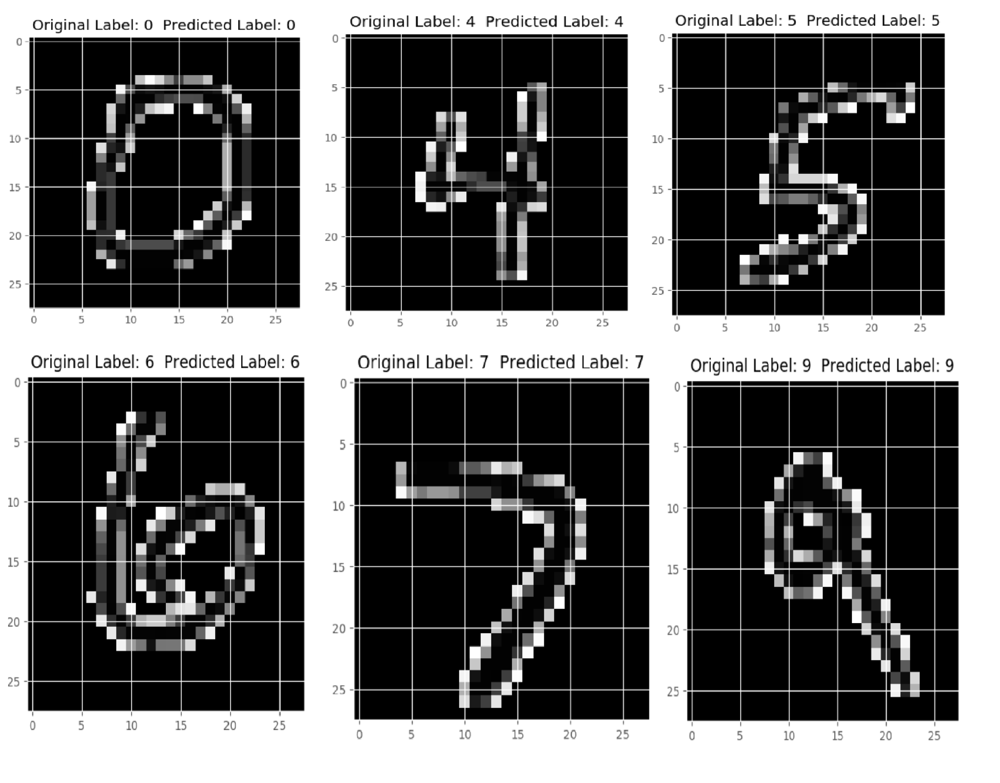

# Handwritten Digit Recognition using Machine Learning and Deep Learning

## Accuracy using Machine Learning Algorithms:

i)	 K Nearest Neighbors: 96.67%

ii)	 SVM:	97.91%

iii) Random Forest Classifier:	96.82%

## Accuracy using Deep Neural Networks:

i)	Three Layer Convolutional Neural Network using Tensorflow:	99.70%

ii)	Three Layer Convolutional Neural Network using Keras and Theano: 98.75%

<<<<<<< HEAD

## layer, output, param image:

## Chart of CNNTraning Accuracy image:

## Prediction Accuracy image:

=======
>>>>>>> 58b8a25ffdef116c65c13e8d023948ecdf068bbf
## Test Images Classification Output:

       

