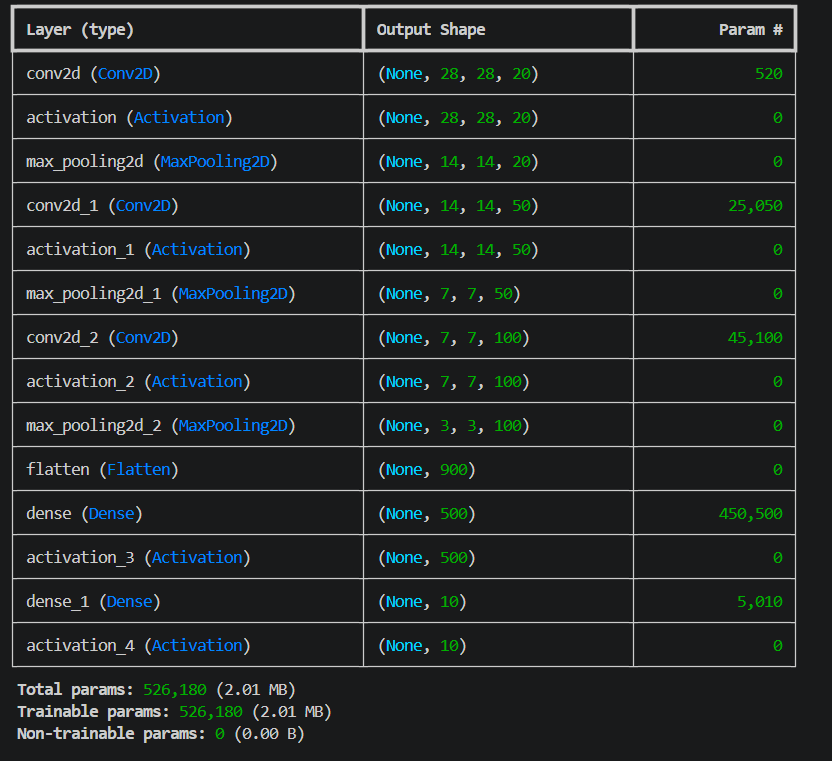
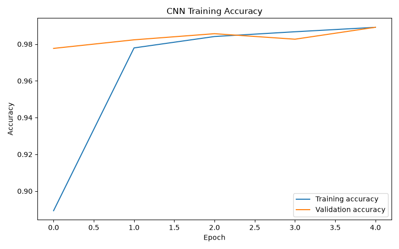
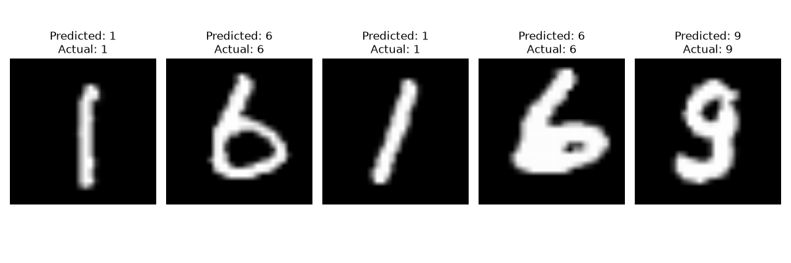

# Handwritten Digit Recognition Using Machine Learning and Deep Learning

## Accuracy Using Machine Learning Algorithms

1. K-Nearest Neighbors (KNN): **96.67%**
2. Support Vector Machine (SVM): **97.91%**
3. Random Forest Classifier: **96.82%**

## Accuracy Using Deep Learning

1. Three-Layer CNN using TensorFlow: **99.70%**
2. Three-Layer CNN using Keras and Theano: **98.75%**

## CNN Layer Output and Parameters

## CNN Training Accuracy

## Prediction Accuracy

## Test Images Classification Output

